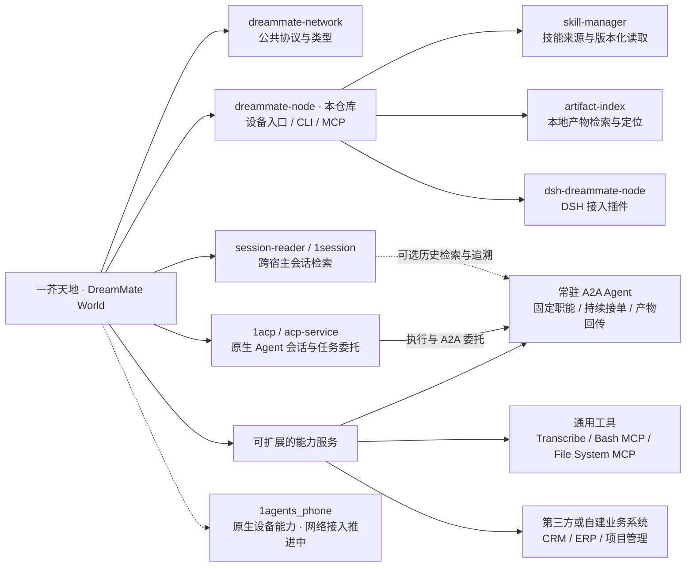

# 一芥天地 · DreamMate World

Personal Agent Infra

**让不同 Agent，共用一套能力网络。**

一芥天地（DreamMate World）是面向 Personal Agent 的能力基础设施（Personal Agent Infrastructure）：把分散在设备、项目和业务系统中的工具、技能、业务服务与专职 Agent 组织起来，供接入的不同 Agent 按需发现、调用或委托任务。已经接好的能力，可以在新的 Agent 和项目中继续使用。

Personal Agent 持续围绕用户的目标、上下文和工作习惯处理任务。日常工作中积累的转写环境、业务系统接口、项目技能，以及历史会话和交付文件，需要长期维护并跨场景复用。一芥天地为这些能力与资产提供独立的维护入口，支持不同 Agent 在后续工作中继续使用。

本仓库提供设备入口 **DreamMate Node**（`@1agents/dreammate-node`），以及同仓的技能管理、产物索引和 DSH 接入包。完整项目关系见下方的[项目族谱与快速跳转](#项目族谱与快速跳转)。

[为什么使用](#为什么使用-一芥天地) · [工作方式](#工作方式) · [项目族谱](#项目族谱与快速跳转) · [业务系统接入](#自定义业务能力) · [常驻 A2A Agent](#固定职能的常驻-a2a-agent) · [快速开始](#跑起来) · [技能共享](#让项目里的-skill-可以被搜索和使用) · [MCP 接入](#添加自定义-mcp) · [安全与边界](#当前支持与边界) · [技术文档](#技术文档)

## 为什么使用 一芥天地

Personal Agent 平台已经逐步提供云电脑、连接器、技能库、定时任务和多 Agent 协作。一芥天地关注的是这些能力在**不同宿主、不同设备和不同项目之间的复用与维护**。

| 工作场景 | 一芥天地提供的价值 |
| --- | --- |
| 同时使用多个 Agent，分别配置工具、复制技能，更新时需要修改多份 | 通过统一入口发现能力；技能原件保留在来源目录，接入的 Agent 按需读取 |
| 软件、脚本、模型和文件分散在多台设备，迁移运行环境很麻烦 | 将已有环境中的服务发布到网络，调用由目标设备执行 |
| 客户、订单、库存等业务数据分布在 CRM、ERP 等系统，不同 Agent 需要分别接入 | 将业务接口封装为能力服务，统一发现与调用，供不同 Agent 和项目复用 |
| 研究、报告制作等工作反复发生，每次都需要重新准备角色、技能和执行环境 | 将固定职能配置为常驻 A2A Agent，复用角色与环境，为新任务建立独立会话并回传交付物 |
| 工具与技能越来越多，难以判断有哪些、怎样使用 | 先按任务搜索摘要，再读取选中方法的参数契约或技能指南 |
| 过去的工作过程和产物分散在不同工具中 | 通过独立服务检索原始会话、文档页面、表格区域或视频片段，保留出处与定位 |

例如：把已有转写引擎作为服务接入后，负责整理录音和负责撰写报告的 Agent 可以调用同一套实现；把项目技能发布后，不同宿主可以读取同一来源的指南和配套资源。新增一个 Agent 时，已有能力可以继续沿用，仍需完成该宿主的接入与权限配置。

这套方式尤其适合同时使用多种 Agent、有多台设备、自建工具或专业处理环境的人。只使用一个 Agent 和少量标准连接器时，可以先使用平台已有能力，按实际复用需求逐步接入一芥天地。

## 工作方式

1. **接入能力**：服务在所在设备向 DreamMate Node 报备；已有 MCP 可以作为来源接入。CRM、ERP 等业务系统可通过现有 MCP 或自定义适配服务接入；专职 Agent 由执行宿主与 A2A 网关提供任务入口。技能和产物由各自独立的提供者管理。
2. **按需发现**：Agent 通过 MCP 或一次性 CLI 搜索工具与技能，只读取当前任务需要的说明。
3. **在目标设备执行**：确认具体方法与参数后，经目标 Node 调用服务；较完整的工作可经 A2A 网关委托给常驻角色，按任务查询状态并获取交付结果。软件和执行依赖留在实际提供能力的设备上。
4. **持续复用**：在能力来源维护工具与技能，供后续任务和其他已接入的 Agent 使用。技能源端更新反映在下次查询中，已运行会话按各自宿主的加载方式处理。

MCP/CLI 是 Agent 使用网络的入口，HTTP 是服务报备与节点调用的接口。跨节点调用要求目标网关可达；网络连接仍需通过已有局域网、Tailnet 或其他网络方案准备。

### 与 Personal Agent 平台的关系

Grok Bot 这类平台提供持续工作的 Agent 和执行环境；一芥天地提供独立维护的能力发现、连接与复用层。平台本身也能接工具和访问设备，一芥天地的选择理由在于：**同一套能力可以供不同 Agent 与项目沿用，减少重复接入和维护的工作。**

支持 MCP 或 CLI 的宿主具备接入基础，具体权限、网络与工具加载方式仍取决于该宿主。DSH 已有[配套插件](packages/dsh-plugin/README.md)；原生 ACP 会话使用独立的工具配置。提及 Grok Bot 用于说明产品关系，不代表本仓库已经完成该平台的端到端适配。

## 项目族谱与快速跳转

这些项目共同组成一芥天地的能力基础设施，各仓库的职责和发布节奏保持独立。下图按职责展示“家族关系”，**不是 npm 依赖树，也不表示需要全部安装**。



### 核心项目

| 项目与快速跳转 | 职责 | 与其他项目的关系 |
| --- | --- | --- |
| [DreamMate Network](https://github.com/scottzx/dreammate-network) · `@1agents/dreammate-network` | Node、Service、Execution 等公共协议、Schema 与类型 | 供各项目使用的公共语言；不运行服务或业务流程 |
| [DreamMate Node](#dreammate-node-设备入口) · `@1agents/dreammate-node` | 每台设备的登记、发现、探活与调用入口；提供 CLI/MCP | 使用协议包，代理本机 HTTP/CLI 服务，连接其他设备的网关 |
| [Skill Manager](packages/skill-manager/README.md) · `@1agents/skill-manager` | 技能来源发现、整包版本、指南及资源读取 | 本仓库独立包，通过 HTTP 向 Node 报备；原件保留在项目或共享目录 |
| [Artifact Index](packages/artifact-index/README.md) · `@1agents/artifact-index` | PDF、PPT、Excel、视频的检索与原始定位 | 本仓库独立包；可向 Node 发布只读服务，复用已登记的本地模型 |
| [Session Reader / 1session](https://github.com/scottzx/session-reader) · `@1agents/session-reader` | 读取与检索多个宿主的原始落盘会话 | 可独立使用、提供 DSH 历史入口，也可作为网络中的会话读取服务，为常驻角色提供历史查询与工作追溯 |
| [1ACP](https://github.com/scottzx/1acp) · `@1agents/acp-service` | 原生 Agent 持久会话、ACP 接入与可选 A2A 委托 | 一个公开包包含运行时、服务、CLI 与 DSH 集成；为常驻角色提供执行与派单基础，A2A 网关可向 Node 报备 |
| [DSH 接入插件](packages/dsh-plugin/README.md) · `@1agents/dsh-dreammate-node` | 在 DeepSeek Harness 中提供能力网络工具 | 本仓库的独立适配包，依赖 Node；复用或按需拉起本机网关 |
| [1agents_phone](https://github.com/scottzx/1agents_phone) | 原生移动端与设备能力项目 | 独立项目；原生能力存在与通过能力网络可调用是不同阶段，具体入网进度以该项目为准 |

Skill Manager、Artifact Index 与 Node 分别安装、维护版本，通过协议协作；它们之间没有彼此的 npm 运行时依赖。DSH 插件则直接依赖 Node。Session Reader 与 ACP 服务是其他独立仓库，安装条件以各项目说明为准。

[DeepSeek Harness（DSH）](https://github.com/deepseek-ai/deepseek-harness) 是外部 Agent 宿主。Node 插件为其提供网络工具，Session Reader 提供历史浏览，ACP 服务提供原生 Agent 会话；三个入口分别安装，职责独立。

### 可复用的能力服务

能力服务包括通用工具、第三方或自建业务系统，以及固定职能的常驻 A2A Agent。工具与业务接口通过方法调用使用；常驻 Agent 接受完整任务，返回执行状态与交付物。网络提供统一的发现与接入入口，具体执行方式由各服务负责。

#### 通用工具能力

| 项目 | 能力 |
| --- | --- |
| [Transcribe](https://github.com/scottzx/transcribe) · `@1agents/transcribe` | 语音转写、逐字稿与字幕输出 |
| [Bash MCP](https://github.com/scottzx/bash-mcp) · `@1agents/bash-mcp` | 终端执行与异步任务 |
| [File System MCP](https://github.com/scottzx/file-system-mcp) · `@1agents/file-system-mcp` | 文件系统操作 |

这些服务按需要部署和报备。具备 CLI/MCP 接口、已安装或出现在项目清单中，都不代表已经在当前设备启动或对网络开放。

#### 自定义业务能力

CRM、ERP、项目管理及其他业务系统，可以将已有接口封装为能力服务。适配层声明方法、参数和返回结构，业务数据与规则继续由原系统管理。完成接入后，同一服务可以供不同 Agent 复用，减少按宿主重复编写连接逻辑的工作。

| 业务系统 | 可封装的能力示例 | Agent 使用场景 |
| --- | --- | --- |
| CRM | 查询客户与商机、读取跟进记录、更新客户状态 | 整理客户背景、准备跟进材料、记录已确认的跟进结果 |
| ERP | 查询订单、库存和应收，创建业务单据草稿 | 汇总订单进度、核对库存、准备经营分析 |
| 项目管理系统 | 查询项目与工作项、创建任务、更新进度 | 拆解需求、整理待办、汇总项目状态 |
| 自建业务系统 | 按实际接口封装查询、计算、校验和业务操作 | 将已有业务流程接入 Agent 的工作过程 |

上表是能力封装示例，具体可用方法取决于业务系统接口、适配实现与授权范围。

接入方式包括：

- **已有 MCP 服务**：通过[自定义 MCP 接入](docs/custom-mcp.md)连接本地 stdio 或远程 MCP，复用上游工具契约。
- **已有业务 API 或 SDK**：编写符合 Node 调用约定的 HTTP/CLI 适配服务，或包装为 MCP，再接入能力网络。方法契约与报备方式见[服务报备说明](#服务怎么报备)。
- **需要隔离调用身份**：通过[客户端私有配置](docs/custom-mcp.md#客户端私有配置独立-token-身份)使用不同上游 Token，权限校验由业务系统执行。

已有[Plane MCP 桥接示例](deploy/plane-bridge/README.md)展示了复用业务系统 MCP、声明方法契约并接入 Node 的路径。[ERP 独立 Token 配置示例](docs/custom-mcp.md#客户端私有配置独立-token-身份)说明了管理员与只读身份的区分方式。

业务写入与审批规则由上游系统及 Agent 宿主落实；当前网络共用模式不会自动增加按用户、Agent 或业务方法划分的权限控制。接口适配与数据同步分别实现，接入能力网络不会自动建立系统间同步流程。

#### 固定职能的常驻 A2A Agent

基于 ACP Service 的执行与 A2A 委托能力，可以将已有技能和执行环境组织为**固定职能、持续接单的常驻智能体**，并按需结合 Session Reader 的历史读取与检索能力。角色长期保留职责范围、技能绑定、工作目录和交付约定，由上游 Agent 按需派发任务。

| 组成 | 职责 |
| --- | --- |
| 固定角色与技能 | 定义职能、输入输出、使用规范和验收要求，复用已绑定的技能及运行依赖 |
| ACP Service 与执行宿主 | 提供原生 Agent 执行和会话承载；新任务建立独立会话，同一任务的补充与返工可沿用原会话 |
| A2A 网关 | 接收任务委托，跟踪状态，收集结果与产物链接，并将完成通知回投调用方 |
| Session Reader（可选） | 只读检索原始会话，为任务准备、历史核对和交付追溯提供依据 |

可按固定职能配置的角色示例：

| 常驻角色 | 任务范围 | 交付物示例 |
| --- | --- | --- |
| 资料研究 Agent | 围绕指定问题收集材料、核对来源、整理结论 | 研究记录、来源清单与分析报告 |
| 报告与演示制作 Agent | 按指定资料、模板和要求制作报告或演示 | 文档、演示文件与预览图 |
| 客户资料整理 Agent | 调用已授权 CRM 等业务能力，整理客户背景与跟进材料 | 客户简报、跟进草稿与业务记录引用 |

角色配置与宿主服务保持可用，模型按任务调用；多个角色可以共享宿主。角色职能持续保留，任务上下文按任务组织，角色划分本身不构成进程或操作系统隔离。

典型过程是：上游提交任务与输入 → 常驻角色在任务会话中执行 → 生成结果与产物链接 → 调用方接收通知或查询结果 → 核验交付并确认处理。Session Reader 为其中的历史查询和过程追溯提供支持，不承担派单或执行。

配置与接口见 [ACP Service / A2A 说明](https://github.com/scottzx/1acp/blob/main/packages/service/README.md)和 [Session Reader](https://github.com/scottzx/session-reader)。当前 A2A 执行端由 DSH 宿主承载，独立 `acp-service serve` 提供 ACP 会话接口。A2A 需显式启用并完成角色、技能和宿主配置；完成通知、产物可访问性及主会话自动唤醒需要分别验证，主会话唤醒依赖接收宿主适配。

### 相关工具与历史分支

| 项目 | 关系与跳转 |
| --- | --- |
| [Feature Blueprint / 思维导图](https://github.com/scottzx/feature-blueprint) | 思维导图、自由画布、CLI 与 DSH 工具；可独立使用。Voice Canvas 源码已迁入其 `canvas/`，随根包统一构建与发布 |
| [Voice Canvas 来源仓](https://github.com/scottzx/voice-canvas) | 画布模块的来源与历史记录，当前安装入口以 Feature Blueprint 为准 |
| [myContext](https://github.com/scottzx/myContext) | 相关上下文工具；独立项目，不是 Node 的必装组件 |
| [老板 IP 工作台](https://github.com/scottzx/boss-ip) | 业务应用分支 |
| [DSH Plugin Registry](https://github.com/scottzx/dsh-plugin-registry) / [Awesome DSH Plugin](https://github.com/scottzx/awesome-dsh-plugin) | 插件登记与目录项目 |
| [早期 1Agents 工作台](https://github.com/scottzx/1Agents) | 已停止开发的历史工作台，保留源码与沿革；当前能力网络不要求部署该工作台及旧服务端 |

完整名称、别名、仓库和包身份保存在 [项目身份清单](ecosystem/projects.json)；其中版本为审计时点的记录。实际安装与兼容要求以各项目当前说明为准，依赖核验与发布记录方式见[生态维护说明](ecosystem/README.md)。

## 当前支持与边界

- **现有能力**：节点与工具发现、方法契约读取、HTTP/CLI 调用、外部 MCP 接入、技能检索与版本化读取、部分服务启停；会话和产物检索由独立服务提供。
- **部署条件**：能力需要预先安装或封装、报备并保持可达。只读到技能指南，不会自动获得执行脚本所需的软件、模型或设备；来源设备离线时，无法继续读取其技能。
- **共享范围**：网络来源支持 `local` / `network`。当前网络共用模式基于可信主机与网络；按客户端 Token 使用独立上游身份另有[私有配置](docs/custom-mcp.md#客户端私有配置独立-token-身份)，尚无覆盖整个共享网络的按用户、Agent、方法细分授权。
- **历史与产物**：会话读取保留原始记录，产物需显式建立索引并开放共享；各平台的全部记忆、人格与运行状态没有自动同步。
- **任务协作**：固定职能常驻 Agent 复用角色、技能和执行环境，原生会话与 A2A 由 ACP 服务及执行宿主承载，历史读取由 Session Reader 提供；A2A 默认关闭，完成通知唤醒主 Agent 需要接收宿主适配。

## 技术文档

| 文档 | 内容 |
| --- | --- |
| [渐进式能力发现](docs/architecture-mcp-mesh.md) | 工具搜索、按需读取契约及架构演进 |
| [自定义 MCP 接入](docs/custom-mcp.md) | 外部 MCP、共享范围、客户端私有身份 |
| [本地向量模型](docs/local-embeddings.md) | 模型准备、按需加载、共享与故障排查 |
| [工具检索评估](docs/tool-search-evaluation.md) / [产物检索评估](docs/artifact-index-evaluation.md) | 已记录的测评结果与适用范围 |
| [安全架构设计](docs/security-architecture.md) | 当前安全模型与后续设计，规划项以文档进度为准 |

下面是 DreamMate Node 的安装、服务报备、调用和诊断说明。

## DreamMate Node 设备入口

> DreamMate Network 的**本机 node agent**：让设备和软件向智能体公开自身能力，并提供统一的发现与调用入口。
> 服务端固定监听 **36908**；`cli` 模式按需执行，不监听端口。运行时依赖 L0 协议包与 MCP SDK。

一台机器跑一个。它是这台机器对网络的唯一入口，负责**登记、发现、执行**——
外部节点探这一个端口，就能知道这台机器上有什么，并经由它发起调用。
它不承担业务流程：什么时候处理新录音、如何判断客户、如何生成跟进事项，仍需要业务流程或智能体承担。

```
        Control Plane / 任意节点 / 智能体
                  │  探 36908（每台机器只探一个端口）
                  ▼
        node-agent :36908
         ├─ GET  /manifest                      本机聚合视图：节点身份 + 已报备服务
         ├─ GET  /health
         ├─ GET  /nodes                         本 tailnet 内的设备节点
         ├─ GET  /device                        设备型号、系统及本地网卡地址/掩码/MAC
         ├─ GET  /services                      各服务的存活与可达性
         ├─ POST /services                      服务报备（**仅接受 localhost**）
         ├─ DELETE /services/:id
         ├─ POST /services/:id/invoke           统一调用（转发到本机 HTTP 或 CLI）
         ├─ POST /capabilities/:name/invoke
         ├─ POST /services/:id/start|stop       部分服务的启停
         └─ GET  /services/:id/skills/:name/archive
                  ▲
      ┌───────────┼──────────────────────┐  localhost 报备
 session-reader :7777   skill-manager :36909   task-service :xxxx
```

这把 pull 探测的成本从「N 个节点 × M 个端口」降到「N × 1」，
并把「找到能力」和「执行调用」收成同一个入口。

## 跑起来

基础设备信息附在 `/manifest` 的 `metadata.device` 和 `/nodes` 的本机条目中；新版 MCP/CLI 可读取设备型号、系统、主机名及本地网卡信息。仅采集本机已有信息，不进行节点间探测或局域网分组。见 [基础设备信息](docs/device-info.md)。

DeepSeek Harness 可以直接安装配套插件，复用本机已运行的 node，未启动时自动拉起：

```bash
pnpm dsh plugin --profile web add @1agents/dsh-dreammate-node
# 重启 DSH 后生效；desktop 使用 --profile desktop
```

当前仓库中的 DSH 插件依赖 `@1agents/dreammate-node ^0.15.0`，直接注册该依赖导出的 MCP 元工具，覆盖工具与技能搜索、契约读取及调用等入口，默认使用本机 `36908`。
DSH 插件需要 Node.js >=22.19；旧 profile 应按插件说明同步更新依赖与锁文件，已有运行中的网关需单独核对版本。
配置与进程生命周期见 [DSH 插件说明](packages/dsh-plugin/README.md)。

```bash
npm i -g @1agents/dreammate-node
dreammate-node install      # 装成开机自启的常驻服务
dreammate-node status       # 看服务与端口状态
dreammate-node uninstall
```

macOS 装 launchd LaunchAgent（`~/Library/LaunchAgents/work.dreammate.node.plist`），
Linux 装 systemd user unit（`~/.config/systemd/user/dreammate-node.service`），
**两边都不需要 sudo**，服务配置、日志与状态文件保存在当前用户目录。
进程退出后自动重启（KeepAlive / Restart=always），日志位于 `~/.1agents/logs/`。

> Linux 用户级 systemd 服务在登出后会停止，服务器长期运行需启用 linger：
> `sudo loginctl enable-linger <user>`。`install` 会检测并提示。

前台跑（调试用）：

```bash
dreammate-node                        # 0.0.0.0:36908
dreammate-node --host 127.0.0.1       # 只对本机可见
```

### npm 安装时自动安装对应 skill

包内包含两份同名 `dreammate-node` skill，安装时只选择一种：

| 环境 | 安装的指引 |
| --- | --- |
| iSH（Linux 内核版本含 `ish` 标记，或存在 `/proc/ish`） | 一次性 CLI 与手动地址缓存，连接其他设备的网关，不启动本机守护进程 |
| 其他终端 | 远程 CLI、本机网关、报备与 MCP；仅远程调用时无需安装本机网关 |

`postinstall` 默认写入 `~/.agents/skills/dreammate-node/SKILL.md`，并同步到**已存在**的
`~/.claude/skills`、`${CODEX_HOME:-~/.codex}/skills`、`~/.gemini/skills` 和
`~/.gemini/config/skills` 下的 `dreammate-node` 目录。它不联网、不启动服务、不修改 MCP
配置。CLI 不运行常驻进程；skill 文件只在 npm 安装或手动补装时写入，设备地址簿则由用户手动导入更新。

默认自动识别不依赖 Alpine、CPU 架构或主机名；普通 Alpine 不会仅因发行版被判为 iSH。
安装记录保存来源、版本和内容校验值：未改动的本包 skill 可自动升级或切换版本，用户自建或
修改过的同名 skill 会保留并提示路径。某个目录安装失败不影响其他目录或 npm 包安装。

```bash
# 安装脚本被禁用、后装智能体、识别不符时，手动补装
dreammate-node skills install
dreammate-node skills install --profile ish
dreammate-node skills install --profile terminal --dir ~/.agents/skills

# 安装时覆盖识别结果或目标目录（--dir/环境变量指向 skills 根目录）
DREAMMATE_SKILL_PROFILE=ish npm i -g @1agents/dreammate-node
DREAMMATE_SKILLS_DIR="$HOME/.agents/skills" npm i -g @1agents/dreammate-node

# 跳过自动 skill 安装，不影响以后手动补装
DREAMMATE_SKIP_SKILLS=1 npm i -g @1agents/dreammate-node
```

`--profile auto|ish|terminal` 优先于 `DREAMMATE_SKILL_PROFILE`；`--dir` 优先于
`DREAMMATE_SKILLS_DIR`，指定目录时只安装该处，目录须为绝对路径或以 `~/` 开头。
源码目录尚未构建时可用 `npm run skills:install -- --profile ish`。安装/同步后由智能体重新
加载技能；已打开的会话是否立即更新取决于宿主。`npm --ignore-scripts` 或安装脚本策略可阻止
自动执行，此时使用手动补装命令。`dreammate-node uninstall` 仅卸载守护进程，保留 skill。

### 让项目里的 Skill 可以被搜索和使用

本机技能目录发现、来源配置、包版本和资源读取由独立包
[`@1agents/skill-manager`](packages/skill-manager/README.md) 负责。它是独立服务，
通过本机 HTTP 向 Node 报备技能管理能力；Node 发现并调用该服务，提供 HTTP/MCP、跨节点发现与检索。
两者位于同一个仓库，npm workspace 仅用于共同开发；生产安装时双方没有彼此的 npm 依赖，
分别维护版本、测试、构建和发布。Skill Manager 核心可脱离网关使用，
接入层使用 Node 的通用报备协议；session-reader 仅是可选的项目目录提供者。

```text
智能体 → Node :36908 → Skill Manager 127.0.0.1:36909 → 技能原目录
                     ↑ 本机服务报备
```

在保存技能原件的设备上安装并运行 Skill Manager：

```sh
npm i -g @1agents/skill-manager
dreammate-skills serve --agent http://127.0.0.1:36908
# macOS / Linux systemd user 长期托管
dreammate-skills install --agent http://127.0.0.1:36908
dreammate-skills status
```

默认只监听 `127.0.0.1:36909`。`serve` 可指定 `--port`、`--config`，
`--no-projects` 关闭项目目录枚举，`--no-register` 仅运行本地服务。
它每 15 秒向 Node 重报备，网关尚未启动或暂时离线不影响本地 CLI、目录读取和服务运行。
Node 重启后由下一轮报备恢复接入；两个守护进程分别安装、检查和卸载。

```sh
npm ci
npm run build                          # 只构建 Node，无需构建 Skill Manager
npm run typecheck && npm test           # 只检查 Node
npm run skill-manager:check            # 独立类型检查、测试和构建
npm run artifact-index:check            # 独立产物索引的 Node/Python 测试
npm run test:packages                   # 验证三个发布包独立安装、消费与服务报备
npm run check:all                       # 全仓检查及独立服务的集成验收
```

独立版本与发布方式见 [Skill Manager 开发与发布说明](packages/skill-manager/README.md)，双方发布没有先后依赖。
Node 自带指南的 `postinstall` 仍由 Node 维护，它属于该产品的安装流程。

历史 `service.skills` 随服务附带的 SOP 及归档接口保留原有轻量兼容实现；
项目来源发现、来源配置和版本化资源读取只由 Skill Manager 实现。

Skill Manager 启动时自动发现常见共享目录，随后在后台通过可选的 `1session projects --global --json`
补充项目技能，每五分钟刷新候选来源。普通搜索只读取已知来源，不启动会话枚举。
也可立即触发一次自动登记：

```sh
dreammate-node skills discover
dreammate-node skills discover --no-projects
```

共享目录采用已知约定：`~/.agents/skills`、Claude、Codex、Gemini、Antigravity、Grok、DSH
的用户目录及相应环境变量；系统目录包括 `/etc/codex/skills` 和平台对应的 1agents 共享目录。
只登记本机实际存在的目录，现有链接技能按目标真实路径去重，手工登记的来源优先。
session-reader 提供会话记录的工作目录及归并后的项目路径；历史路径需先在本机核验，
并补充最近 Git 根目录，不扫描整个磁盘。它记录的是会话工作目录，不保证包含每次命令切换过的全部 PWD。
没有安装 reader 或枚举失败时，返回独立诊断，共享目录和手工来源仍然可用。
移除自动来源会记录排除项，后续自动刷新不会重新加回；源技能文件始终保留。

在保存技能原件的设备上登记来源。项目模式扫描 `.agents/skills`、`.claude/skills` 和
其他常见智能体约定的技能目录；也可以直接登记一个技能包或技能集合目录。登记操作通过本机 loopback
网关转发到已报备的 Skill Manager，配置保存在 `~/.1agents/skill-sources.json`；服务重启后恢复。
独立 CLI 改写配置后，Skill Manager 会在后续读取时自动加载。并发写入以同目录 `.lock` 文件互斥，冲突返回 409，重试即可；
异常退出遗留锁时，先检查锁记录中的 PID 已停止，再删除该锁文件并重试，正常写入会自动清理锁。

```sh
dreammate-node skills add --name sample-project --project /absolute/path/to/project
dreammate-node skills add --name sample-skills --dir /absolute/path/to/skills
dreammate-node skills list
dreammate-node skills refresh skills-sample-project
dreammate-node skills remove skills-sample-project
```

只登记需要发布的目录：目录中的技能指南和未排除的配套文件可经网关读取。
单个技能包需要 `SKILL.md`（优先使用 `SKILL.remote.md`）及非空名称、用途说明。
正文、脚本、参考资料和素材保留在原目录；只持久保存来源配置，不复制到各宿主的技能目录。
每次查询从源端重新扫描，新增、修改和删除自动反映到目录，缺失或无效来源有独立诊断。
包内符号链接、隐藏文件、`node_modules` 和凭据文件不发布，扫描有数量、深度和大小上界。

任意可达的客户端先搜索摘要，再用结果中的 `node`、`id`、`revision` 读取完整指南：

```sh
dreammate-node cli search-skills --agent http://GATEWAY:36908 --query '改进三维场景的灯光和材质'
dreammate-node cli search-skills --agent http://GATEWAY:36908 --query 'CAD 提取' --source skills-sample-skills
dreammate-node cli read-skill --agent http://GATEWAY:36908 --node DEVICE --skill SKILL_ID --revision HASH
dreammate-node cli read-skill --agent http://GATEWAY:36908 --node DEVICE --skill SKILL_ID --revision HASH --resource references/stages.md
```

`DEVICE`、`SKILL_ID`、`HASH` 都取真实搜索结果；资源路径不含 Markdown 的 `#锚点`。
搜索默认跨已知节点，支持 `--node localhost`、`--limit`、`--offset`、`--max-chars`。
关键词与可选向量检索复用现有模型发现及预算策略；结果只含技能摘要，不携带正文或脚本。
向量是可重建的检索索引，不承担内容存储；按需模型可持久保存文档向量，原技能仍在来源目录。来源不在线时无法读取其技能。
语义检索默认共享 5 秒模型预算，超时仍返回关键词结果。CPU 模型响应较慢时可显式设置
`DREAMMATE_EMBEDDING_TIMEOUT_MS=15000`，并让 CLI 的 `--timeout-ms` 覆盖节点发现及模型预算。

正文加载后可直接供当前会话使用。返回的资源清单只含相对路径与文件大小，配套资源按需读取，
二进制以 base64 返回。整个发布包的内容哈希作为 `revision`，脚本或文档变化时旧版本读取
返回 HTTP 409 / `SKILL_REVISION_CHANGED`，需要重新搜索并读取。读取不执行脚本；设备软件、
图纸及运行依赖属于实际执行节点，远程读取指南不等于具备在客户端运行脚本的环境。
`revision` 是 Skill Manager 计算的整包版本令牌；业务工件合同里的 `skill.sha256` 若另有计算规范，仍按其规范生成，二者不直接互换。

MCP 对应 `dreammate_search_skills` → `dreammate_read_skill`。HTTP 为分页
`GET /skills?limit=100&offset=0`、`GET /skills/:id?revision=HASH&resource=PATH`；
来源管理为仅 loopback 的 `GET|POST /skills/sources`、`DELETE /skills/sources/:id`、
`POST /skills/sources/discover`、`POST /skills/sources/:id/refresh`（或 `/skills/sources/refresh` 刷新全部）。
这些路径是 Node 的协议适配层，只代理已报备且声明
`metadata.skill_provider.protocol = "dreammate.skills.v1"` 的服务。
没有已报备的技能服务时返回 HTTP 503，表示服务未接入；Node 不会扫描目录或自行启动 Manager。
来源管理方法同时受 Node 通用 `metadata.local_only_methods` 限制，仅允许 loopback 调用。
旧网关未提供目录接口时，
跨节点搜索保留 `unsupported` 扫描诊断与 `partial`，不能把它解释为节点没有技能。

### 本地文件和视频的统一产物索引

[`@1agents/artifact-index`](packages/artifact-index/README.md) 是另一独立 npm 包，提供 CLI、ESM 库和可选的只读服务。
它索引显式传入的 PDF、PPT/PPTX、Excel 与视频，保留页码、幻灯片编号、工作表/单元格范围和时间片段，
支持先搜索摘要、再读取原始定位对应的内容。Node 和产物索引互无 npm 运行时依赖，安装 Node 不会附带索引数据库或用户文件。

产物索引复用工具检索使用的同一组本地 Qwen/Gemma 模型服务，不下载另一份模型，也不启动额外模型进程。
文字采用专用文档 profile，视觉采用 Gemma；共享调度器继续负责互斥加载与空闲卸载。
文档 profile 需要本次配套更新后的调度器，旧服务会明确返回不可用并保留文字词法降级。
本地解析依赖、离线隔离等级、当前文件支持边界及源码安装方式见该包说明。

```text
智能体 → Node :36908 → Artifact Index 127.0.0.1:36910 → 本地索引和原始定位
                              └─ 复用已登记的 Qwen/Gemma 模型服务
```

产物服务只读，新增/更新/删除索引由本机 CLI 显式执行；默认 `local`，网络发布只返回显式标记为 `network` 的资源。

### Mac 按需使用本地向量模型

已准备本地 Python 环境和 Qwen 权重后，可以安装轻量启动器。下面在已准备模型的仓库根目录执行：

```sh
dreammate-node embedding install \
  --python "$PWD/.local/tool-search/venv/bin/python" \
  --manifest "$PWD/.local/tool-search/manifest.json" \
  --device mps --batch-size 8 --idle-timeout-ms 300000 --priority 100 --sharing local
dreammate-node embedding status
dreammate-node embedding uninstall
```

优先级和共享范围可持久配置：`dreammate-node embedding config` 查看，
`dreammate-node embedding config --priority 100 --sharing local` 修改。
默认文件 `~/.1agents/embedding-config.json` 的 `priority` 覆盖安装时的 `--priority` 兜底值，数值越大越优先。
运行中的启动器每 15 秒重读并更新报备，无需重启模型或 MCP；配置变更不延长模型空闲时间。
详细格式和异常处理见 [本地模型配置](docs/local-embeddings.md#通过配置调整优先级与待命时间)。

macOS launchd 只保持轻量 HTTP 启动器在线；首次实际编码请求才启动 Python 和模型。
最后一个编码请求结束后默认连续空闲 60 秒，退出 Python 释放模型内存；上例通过 `--idle-timeout-ms 300000` 显式设为 5 分钟，下一次检索重新加载。
已有配置文件中的 `idle_timeout_ms` 优先于安装参数，可通过 `dreammate-node embedding config --idle-timeout-ms 300000` 持久修改。
健康检查和每 15 秒的服务报备不会加载模型或重置空闲时间，多个 CLI/MCP 共用同一个模型进程。
`status` 的 `loaded`、`loading`、`worker_pid`、`idle_timeout_ms` 分别报告模型状态，启动器在线不等于模型已加载。
按需运行器将文档文本哈希及向量保存在 `~/.1agents/cache/embeddings/`，不保存原文或查询。
模型卸载后保留该缓存，下一次启动按模型版本和编码配置校验恢复，避免反复编码整个目录。

默认服务优先级为 100，高于普通远端模型的 0；默认全网搜索会先尝试本机这个服务，失败时仍按现有预算尝试备用。
`sharing: local` 仅允许本机 Agent 发现和使用模型，其他设备不能经网关调用；
本机仍可使用网络共享的远端备用模型。`network` 才会向其他设备开放本模型，旧配置省略时保持网络共享行为。
显式 `--node localhost` 没有远端回退，与模型共享范围分别配置。
不设置固定 `DREAMMATE_EMBEDDING_URL`，已有 MCP 可在后续搜索中自动发现新服务。
首次模型加载和未缓存的目录编码都计入语义预算，显式超时优先于按需服务声明的冷启动预算。
独立 CLI 不继承 MCP 宿主的专属配置；若需 30 秒语义预算，可显式设置 `DREAMMATE_EMBEDDING_TIMEOUT_MS=30000`，
并以 `--timeout-ms 60000` 为整条命令预留发现时间。
这一步不下载模型，安装路径、完整生命周期及故障说明见 [本地模型文档](docs/local-embeddings.md)。

## iSH / 无常驻进程的客户端

如果设备主要调用其他机器上的服务，使用 `dreammate-node cli`。每次运行直接请求
一台在线设备的 node-agent，输出 JSON 后退出，不启动本机 HTTP/MCP 服务，不执行
Tailscale CLI，不生成本机身份或服务注册表。可以手动导入一份持久化的设备地址簿；日常调用只读缓存，不后台刷新。桌面和服务器上的常驻模式继续可用。

```bash
# 地址应替换为可由 iSH 访问的已运行网关地址
export DREAMMATE_AGENT_URL=http://100.x.y.z:36908

dreammate-node cli nodes
dreammate-node cli search --query '读取笔记'           # 默认跨已知节点搜索，最多 15 条方法摘要
dreammate-node cli search --query '读取笔记' --node localhost # 只搜入口网关所在设备
dreammate-node cli services                 # 分页浏览入口网关上的服务摘要
dreammate-node cli services --node all      # 显式浏览：从入口网关取清单，再直连各节点
dreammate-node cli inspect --node sample-mac --service notes # 仅分页方法摘要
dreammate-node cli inspect --node sample-mac --service notes --method read
dreammate-node cli invoke --node sample-mac --service notes --method read --params '{"id":"123"}'

# 较大参数可通过标准输入提供
cat params.json | dreammate-node cli invoke --service notes --method read --params -
dreammate-node cli manage --service notes --action status
dreammate-node cli tools                    # 离线查看工具的参数 Schema
dreammate-node cli --help
```

业务调用首选 `search → inspect --method → invoke`。`search` 必须提供 1–2000 字符的非空 `--query`，
默认跨已知节点搜索，只返回方法摘要；`--node localhost` 限定入口网关所在设备，也支持
指定节点、`--service ID` 和 `--kind TYPE` 过滤。结果在相关性门槛与预算允许时尽量覆盖
2–3 个工具集，按 `service_id` 区分，跨节点相同 ID 仍算一个集；不强求不同节点或用不相关结果凑数。
显式 `--service ID` 时只搜该集。
`search`、`services` 和 `inspect` 支持 `--limit`、`--offset`、`--max-chars`：
每页 1–20 条（搜索默认最多 15，目录默认 10），偏移 0–1000000，摘要 JSON 预算 1000–12000
字符（搜索默认 12000，目录默认 6000，并非 token 估计）。相关候选不足或字符预算不够时返回更少结果。
分页与查询参数在联网前校验；候选不合适时改写查询或显式翻页。
省略 `inspect --method` 只返回方法摘要目录，不再展开整个服务的参数 Schema。
`results` 中的 `score` 是排序信号，不是可执行性或置信概率；当前没有拒识分类器。
先确认候选说明符合任务再 inspect，不符合时继续改写查询，不能因有返回结果就调用。

入口优先级：`--agent` → `DREAMMATE_AGENT_URL` → 已导入地址簿的 `default_node`。
`search` 省略 `--node` 时扫描已知节点；其他命令省略时目标是**入口网关所在设备**。
有缓存时按缓存解析节点名称、ID、DNS 名或 IP；
没有缓存时通过入口网关的 `/nodes` 解析，然后由客户端直连目标节点。入口网关不是跨节点
中继，所以目标网关也必须从 iSH 可达。CLI 不需要本机运行 `tailscaled`，但网络连通性需要自行配置。

### 手动同步设备地址簿

设备列表比较稳定时，在 Mac 或其他能读取节点清单的终端导出，再把 JSON 文件传给 iSH：

```bash
# 在 Mac：读取已运行的本机网关；也可 --agent 指向其他在线网关
# --default-node 可以是节点名或 ID；省略时使用导出来源网关的自身节点
dreammate-node cli nodes export --default-node scott-pc-1 --file nodes.json

# 把 nodes.json 传到 iSH 后：校验并完整替换本地缓存
dreammate-node cli nodes import --file nodes.json
dreammate-node cli nodes                          # 离线查看缓存，不探测
dreammate-node cli services                       # 主动访问默认的 scott-pc-1
dreammate-node cli services --node scott-pc-1
dreammate-node cli services --node all             # 主动查询缓存中的所有地址
```

设备地址簿由用户单独传输，`nodes.json` 不随 npm 包分发；安装包只包含程序与通用 skill。

缓存默认保存在 `~/.1agents/nodes.json`，可用 `--nodes-file PATH` 或
`DREAMMATE_NODES_FILE` 覆盖。缓存**没有自动过期或后台更新**；设备变化时重新导出、导入。
导入验证格式、版本、默认节点和别名唯一性，校验失败保留原缓存，成功时原子替换，不保留已删除设备。
导出省略 `--file` 时直接输出 JSON；导入支持 `--file -` 从 stdin 读取。

文件只存节点 ID、名称、类型和网关地址等路由信息，不保存凭据、源设备 `is_self` 标记或在线状态。
因此从 Mac 导入不会把 Mac 误认成 iSH 本机。缓存节点列表的 `online`、`network_online` 和
`gateway_reachable` 都是 `null`，并显示导出/导入时间；不是实时在线证明。
`services --node all` 的扫描结果是实时的，但 `discovery.status=cached`、`scope=imported_nodes_only`
和 `partial=true` 明确表示只覆盖导入清单，不能保证包含当前整个 tailnet。

需要临时忽略缓存时使用 `--live --agent URL`，例如：

```bash
dreammate-node cli nodes --live --agent http://scott-pc-1:36908
```

`--live` 不覆盖缓存。缓存里缺少某个名称时会报错，避免偷偷依赖拓扑发现；可重新导入或通过
`--node http://设备地址:36908` 显式直连。连接失败不会自动重试写调用。
如果当前只有一个已知可达设备，也可手动准备以下格式后导入（地址须替换为实际可达地址）：

```json
{
  "format": "dreammate.nodes",
  "version": 1,
  "exported_at": "2026-09-29T00:00:00Z",
  "default_node": "pc-1",
  "nodes": [
    { "node_id": "pc-1", "name": "scott-pc-1", "type": "windows", "agent_url": "http://scott-pc-1:36908" }
  ]
}
```

地址簿不建立 VPN 隧道；它利用已有的出站 TCP 连通性，也不会让 iSH 自动变成可被远程访问的节点。

当缓存的 HTTP 地址使用节点自身名称或 `dnsName`，且带有 `ipv4` 时，CLI 会优先使用该 IP，
保留端口与路径，以减少 MagicDNS 抖动的影响。HTTPS、代理域名及显式 `--agent URL` 保持原地址。
`--node all` 仍逐个直连缓存节点，`--agent` 不会把这些请求改为经入口转发。
没有缓存或默认入口时，也可用 `services --node IP` 或 `--node http://HOST:PORT` 直接查询已知设备。

服务扫描每个节点最多等待 3 秒（包括响应体），保留成功节点和失败诊断。
单次 CLI 命令默认最多运行 30 秒，`invoke` 默认 150 秒；可用 `--timeout-ms N` 调整。
达到命令截止时间会输出 `COMMAND_TIMEOUT` 并以退出码 1 退出；写调用可能已经执行，先核对远端结果。
结果写完后 CLI 退出，不再等待残留的 DNS 任务。不要把空 stdout 当作“没有服务”：
应同时检查退出码、stderr、`isError` 以及扫描的 `partial` / `scans`。

```sh
dreammate-node cli services --node all --timeout-ms 15000
dreammate-node cli nodes export --help
dreammate-node cli nodes import --help
```

iSH 使用手动导入和单次调用；无需为此启动本机 daemon 或 tailscaled。
`install` 会拒绝 iSH，并在普通 Linux 写入 unit 前检查 systemd 用户管理器是否可用。
端口拒绝连接只表示当时网关不可达，不能据此断定软件没安装。

stdout 输出完整 MCP 结果 JSON，保留 `content`、`structuredContent`、`isError` 和
元数据；脚本可用 `jq` 提取。退出码 `0` 表示成功，`1` 表示网络、HTTP 或 MCP 业务错误，
`2` 表示参数错误（stdout 返回错误结果，同时在 stderr 写入诊断 JSON）。调用不会自动重试，避免重复执行写操作。
`manage start|stop` 会改变远端服务状态；本机仍不运行常驻进程。

这个模式仍需要 **Node.js >=22.5**，解决的是“不常驻”，不是“无需 Node.js”。
用户已在 iSH 完成 0.8.0 安装、地址簿导入及离线列节点；后续超时修复通过本地故障注入测试，
仍需 iSH 真机复验。它不会让 iSH 成为可随时被远程调用的服务提供节点。

当前源码可用 `npm install && npm run build` 构建，再运行
`node dist/bin/dreammate-node.js cli ...`；若需要命令名，可在源码目录执行 `npm link`。

## 服务怎么报备

```ts
import { reportAndHoldRegistration } from '@1agents/dreammate-node/client';

await reportAndHoldRegistration({
  id: 'session-registry',
  kind: 'session_registry',
  capabilities: ['sessions.list', 'sessions.read'],
  port: 7777,
  reachability: 'localhost',   // 或 'network'
});
```

**服务报备是可选的。** Node 未安装、未启动或报备请求失败时，客户端通过 `ok` / `reason`
返回结果，业务服务可据此处理并继续运行。监听[协议约定端口](https://github.com/scottzx/dreammate-network)
且提供 `/manifest` 的服务，还可在 Node 启动时被探测登记。

## 两件容易想错的事

**Node 在线 ≠ Service 在线。** tailnet 的 `Online` 只说明机器开着；进程被 kill
后仍会报告在线。因此 Node 必须定期探测各服务的 `/health`，连续失败 5 次
才移除——抖一下不该被清掉。

**reachability 不是「能不能被调用」。** `localhost` 表示服务只监听回环，远端调用方**不能直接**连那个端口；`network` 表示服务可被直连。manifest 仍然如实报告可达性，避免给一个看着能连、连上却超时的地址。

但 node agent **会做代理**：跨节点调用走 `:36908` 的 `POST /services/:id/invoke`（或 MCP `dreammate_invoke`），再转发到本机回环 HTTP 或本地 CLI（`execution: cli|http|hybrid`）。因此 `reachability: localhost` 的服务仍然可以被远端智能体使用——只是不能绕过 agent 直连那个端口。

## 智能体怎么发现和调用

智能体不需要直连各服务端口。本机跑 `dreammate-node mcp` 后，暴露一组**稳定的元工具**：
业务任务首选 `search → inspect(method) → invoke`；服务列表用于显式浏览。
搜索和目录都有条数与文本预算，省略方法的 inspect 只返回摘要目录，堵住自动全量展开的路径。
只有选定具体方法后才展开该方法的参数 Schema；技能指南也按需读取。

| 工具 | 作用 |
|------|------|
| `dreammate_list_nodes` | 发现 Tailnet / 局域网中的设备节点 |
| `dreammate_search_tools` | 必填 `query`，默认跨已知节点检索，最多 15 条方法摘要；相关性允许时尽量覆盖 2–3 个工具集 |
| `dreammate_search_skills` | 必填 `query`，跨节点检索项目或独立目录发布的技能摘要，返回来源和内容版本 |
| `dreammate_read_skill` | 按搜索返回的节点、技能 ID 和 revision 读取完整指南或一个配套资源 |
| `dreammate_list_services` | 分页浏览本机、指定节点或全网（`node: "all"`）已报备服务摘要 |
| `dreammate_list_capabilities` | `list_services` 的向后兼容别名 |
| `dreammate_inspect` | 无 `method` 时分页看摘要目录；指定方法时读取该方法 Schema，或按需读技能指南 |
| `dreammate_invoke` | 经本机或对端 `:36908` 代理执行（HTTP 或本地 CLI） |
| `dreammate_download_skill` | 下载并安装/预览服务配套技能包 |
| `dreammate_manage_service` | 部分服务的生命周期：`start` / `stop` / `status` |

HTTP 侧对应 `GET /nodes`、`POST /services/:id/invoke`、`POST /capabilities/:name/invoke`、`GET /services/:id/skills/:name/archive`、`POST /services/:id/start|stop`；已报备模型另有只读编码路由 `POST /services/:id/embed`。

渐进式发现的设计说明见 [docs/architecture-mcp-mesh.md](docs/architecture-mcp-mesh.md)。

## 添加自定义 MCP

按客户端 Token 隔离权限时，将标准 `mcpServers` 配置保存为权限 600 的
`~/.1agents/mcp-client.json`，由 DreamMate CLI/Stdio MCP 私有加载。通过
`--mcp-config PATH` 选择其他身份；`--node @client` 仅发现和调用当前进程的私有工具。
这些来源不导入共享网关，身份不能通过工具参数切换。配置及 ERP 双 Token 示例见
[客户端私有配置](docs/custom-mcp.md#客户端私有配置独立-token-身份)。

在运行网关的机器上粘贴标准 `mcpServers` JSON，即可连接本地 stdio 或远程 Streamable HTTP / SSE MCP，自动发现工具并接入现有搜索、inspect 和调用：

```bash
dreammate-node mcp add --config '{"mcpServers":{"demo":{"command":"npx","args":["-y","example-mcp-server"]}}}'
dreammate-node mcp add --file ./mcp.json
cat ./mcp.json | dreammate-node mcp add --file -
dreammate-node mcp list
dreammate-node mcp share mcp-demo --scope local
dreammate-node mcp share mcp-demo --scope network
dreammate-node mcp refresh mcp-demo
dreammate-node mcp remove mcp-demo
```

原有 `dreammate-node mcp --agent ...` 仍用于启动面向客户端的 MCP 网关。添加后服务 ID 为 `mcp-<配置名>`，方法为 `mcp-<配置名>.<上游工具名>`。源配置持久化到本机 `~/.1agents/mcp-sources.json`（权限 600），网关重启后自动恢复，连接断开后自动重连。管理入口仅接受本机回环请求。

MCP 接入与共享独立设置：每个来源的 `sharing` 支持 `local` / `network`，省略时默认 `network`，已有配置继续网络内共用。`local` 仅允许通过本网关的回环入口发现、读取契约和调用；远端即使知道服务或方法名也不能访问。可在源 JSON 中设置 `"sharing":"local"`，或用 `mcp share` 单独切换，即时生效并持久保存，无需重连上游。`mcp list` 显示当前共享范围。`reachability: localhost` 只描述上游直连地址，不代表仅本机可调用。

`network` 延续可信网络共用模式，不增加按设备或 Agent 的身份鉴权；允许访问该来源的调用方共用上游凭据。细粒度授权后续再做。

添加时自动遍历标准工具目录；支持子动作目录的来源会进一步展开工具集。Activepieces 自动识别已连接应用，GitHub 等内部动作直接进入搜索，选中后按需加载参数，再通过原有调用入口执行。完整方法名包含来源、工具集和稳定标识；特殊字符自动转换，唯一简称可自动匹配，重名简称会返回候选名称供选择。

远程凭证可通过 `headers` 提供，本地进程可通过 `env` 提供，支持 `${ENV_VAR}` 在网关进程中解析。已有 OAuth 授权可通过 `oauth` 配置 refresh token 自动续期；当前不提供浏览器首次登录。完整配置、HTTP 接口与 Activepieces 示例见 [自定义 MCP 接入](docs/custom-mcp.md)。

搜索自动从本次扫描到的服务中发现已就绪的本地模型，无需为每个 CLI/MCP 客户端填写模型 URL。模型可只运行在一台内网设备上，其他设备无需安装权重。先显式准备离线权重，然后在模型设备的本仓库根目录启动：

```sh
node scripts/local-embeddings/serve.mjs --model qwen3 --port 8766 --agent http://127.0.0.1:36908
```

启动器预热模型，服务只监听 loopback；确认就绪后向本机 agent 登记模型别名、revision、维度、编码配置和优先级，每 15 秒刷新，正常退出时注销。客户端直连选中模型设备的网关，由 `POST /services/<id>/embed` 只代理该设备已登记的本机回环端口；入口网关不承担跨节点中继。多个模型按优先级、健康状态和稳定 URL 排序，最多尝试两个，共享默认 5 秒语义预算；自动发现路径下，单次尝试的查询和文档固定同一模型版本与编码配置。

模型发现范围随 `node`：默认跨已知节点，`node: "localhost"` 只看入口设备；`service_id` 仅筛业务工具，不排除同一节点范围内的模型服务。未发现可见的就绪 provider 时，返回 `search.semantic_status: "no_provider"` 和有界词法结果；存在 `partial` 扫描或导入目录时，不能据此断言全网没有安装模型。模型失败也保留有界词法结果，不展开全量工具。

显式 `DREAMMATE_EMBEDDING_URL` 仍优先并固定使用该地址，失败时不会自动切到发现的模型；`DREAMMATE_EMBEDDING_MODEL` 可限定模型别名。运行时不会下载权重、自动部署模型或选举全局 leader，也不依赖云模型。部署细节与检索评测方法见 [docs/local-embeddings.md](docs/local-embeddings.md)。

## 为什么报备只认回环（与安全模型）

服务报备、MCP 来源配置和技能来源管理入口限制回环（`127.0.0.1`），阻断**外部网络**直接往节点里塞假服务、改动来源或摘除服务。

> ⚠️ **澄清认知误区：回环 ≠ 100% 绝对安全。**  
> `127.0.0.1` 只能防止外部网络机器直连，但**不防同机其他非受信任进程**——任何本地进程都能向 `POST /services` 报备。当前 MVP 基于**受信任主机（Trusted Host）威胁模型**。  
> 后续架构设计（Phase 2）计划引入 **Unix Domain Socket (UDS)**，结合操作系统内核鉴真（`SO_PEERCRED` 提取进程 PID 与可执行文件指纹），并由 Node 权威签发短期 **Capability Lease** 租约，以支持双向身份校验与授权。
> 完整设计见 [安全架构规范文档](docs/security-architecture.md)。

## 节点身份

优先取自 tailnet（`tailscale status --json` 的 `Self`，缓存 60s），本机所有
进程读到同一份，不会各自生成 id 把一台机器裂成几个 Node。

```
node_id   example-tailnet-node-id    ← tailscale ID，重启不变
name      scott-mac            ← DNSName 前缀，不是 HostName
type      macos                ← 由 tailscale 的 OS 映射
```

> ⚠️ 名字取 **DNSName** 而非 HostName：iOS 设备的 HostName 全是 `localhost`，
> 实测一个 11 节点的 tailnet 里只有 9 个 HostName 唯一。

> ⚠️ **找 tailscale 不能只靠 PATH。** launchd 给的 PATH 只有
> `/usr/bin:/bin:/usr/sbin:/sbin`，systemd 的也好不到哪去，而 homebrew 的
> tailscale 在 `/opt/homebrew/bin`。不处理的话，装成常驻服务后会静默回退到
> 本地身份——同一台机器在前台和服务模式下变成**两个 Node**，而且没人会注意到。
> 所以这里除了 PATH 还会依次试几个已知位置，plist / unit 里也补了 PATH。
> 装在别处用 `DREAMMATE_TAILSCALE_BIN` 指定。

没装 / 没登录 tailscale 时静默回退到本地身份（hostname + 首次生成的 uuid，
存在 `~/.1agents/node.json`），`metadata.identity_source` 如实报告来源。

## 它在架构里的位置

node 注册与探活是从 Control Plane 里**领出来**的——原本设想中 Control Plane
的其余职责（Task、Agent 编排、Execution 账本）降级为平级的普通服务，各自独立
起进程、各自向本机 agent 报备。于是不再有「必须先起 Control Plane」的启动顺序，
任何一个服务挂掉也不会让整个控制面消失。

协议定义见 [`@1agents/dreammate-network`](https://github.com/scottzx/dreammate-network)（L0）。

### 发现与调用的诊断字段

- 节点名按本机 `/nodes` 清单解析，优先使用已登记的 Tailscale IP；本机、显式 IP 和带端口的 URL 保持可用。所有 MCP 路由共用解析逻辑，写请求不因网络错误自动重放。
- `dreammate_list_services(node="all")` 返回 `scans`（每个节点的地址、状态、时间与 HTTP/连接错误）、`discovery` 和 `partial`。部分节点失败时仍返回成功结果；全部扫描失败会设置 `isError:true`，不能把零匹配解释为全网无服务。节点清单读取失败时，本机降级会显式标注。
- `dreammate_list_nodes` 保留旧 `online` 字段，增加 `network_online`、`network_checked_at`、`gateway_reachable` 与 `gateway_checked_at`。网关探测针对 `/health`，不代表业务服务可用。旧节点没有可靠网络检查时间时返回 null。
- 服务摘要、inspect 和生命周期 status 返回 `service_health`，包含最后探测时间、探测范围；未探测为 unknown，`methods_verified:false`。方法 inspect 的 `declared`/旧 `defined` 仅指契约声明，`availability` 表示部署证据和调用观测，不能混用。
- `dreammate_invoke` 原样保留有效 MCP 结果的内容块、结构化数据和错误状态；普通业务 JSON 作为结构化结果返回。HTTP 200 仍可能包含 `isError:true`，调用方必须检查它。HTTP 转发超时返回 504，传输失败返回 502，均不自动重试写操作。

Plane 的错误分类、方法观测和当前部署的 Pages 限制见 [bridge 说明](deploy/plane-bridge/README.md)。`npm test` 同时执行 Node 与 Plane bridge 回归测试。
